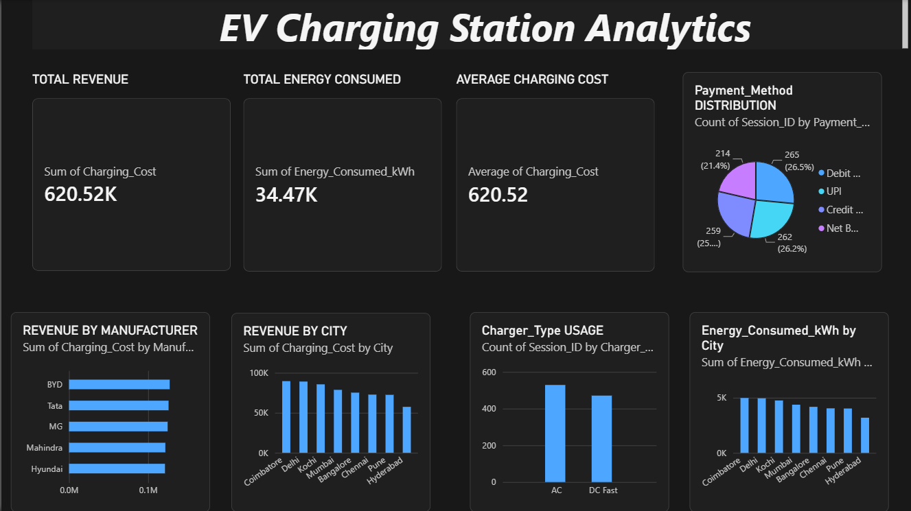

# 🚗⚡ EV Charging Station Analytics

## 📌 Project Overview

This project analyzes Electric Vehicle (EV) charging station data to understand charging patterns, revenue performance, customer behavior, energy consumption, and charging station efficiency.

The project follows an end-to-end data analytics workflow using Python, MySQL, SQL, and Power BI to transform raw data into meaningful business insights.

### 🎯 Project Objectives

* Analyze revenue and charging session performance across cities.
* Identify high-performing EV manufacturers and vehicle models.
* Understand customer charging and payment behavior.
* Evaluate charger utilization and energy consumption.
* Analyze monthly revenue trends.
* Present key performance indicators through a Power BI dashboard.

## 🛠️ Tools & Technologies

| Tool       | Purpose                                   |
| ---------- | ----------------------------------------- |
| Python     | Dataset generation and data analysis      |
| Pandas     | Data manipulation and cleaning            |
| NumPy      | Numerical operations                      |
| Matplotlib | Data visualization                        |
| MySQL      | Data storage and querying                 |
| SQL        | Business analysis and reporting           |
| Power BI   | Interactive dashboard and visualization   |
| GitHub     | Project documentation and version control |

## 📂 Project Structure

```text
EV-Charging-Station-Analytics/
│
├── DATA/
│   └── ev_charging_data.csv
│
├── PYTHON/
│   └── analysis.py
│
├── SQL/
│   └── ev_charging_analysis.sql
│
├── POWER BI/
│   └── EV_Charging_Station_Analytics.pbix
│
├── plots/
│   ├── city_summary.csv
│   ├── monthly_revenue.csv
│   └── [generated analysis charts]
│
├── screenshots/
│   └── ev_charging_dashboard.png
│
├── generate_dataset.py
├── requirements.txt
├── .gitignore
└── README.md
```

*Note: The structure above is the intended project layout. Keep only filenames that actually exist in your repository, and update the names if yours differ.*

## 📊 Dataset Description

The dataset contains EV charging session information, including:

* Session ID
* Customer ID
* Charging Station ID
* City and State
* EV Manufacturer
* Vehicle Model
* Battery Capacity
* Battery Percentage Before and After Charging
* Charger Type and Connector Type
* Session Start and End Time
* Charging Duration
* Energy Consumed (kWh)
* Charging Cost
* Weather Conditions
* Day Type
* Payment Method
* Charging Session Status

The dataset is generated using Python for analytical and educational purposes.

## 🔄 Project Workflow

### 1. Data Generation

Generated an EV charging session dataset using Python and NumPy, with Pandas used to organize the data into a structured DataFrame.

### 2. Data Analysis and Data Quality Checks

Used Pandas to examine the dataset and perform data quality checks, including:

* Dataset structure and data types
* Missing values
* Duplicate records
* Descriptive statistics
* Charging session metrics
* Revenue and energy consumption calculations

### 3. Exploratory Data Analysis (EDA)

Analyzed charging activity and business performance to explore patterns across cities, manufacturers, charger types, payment methods, and time periods.

### 4. Data Visualization

Created visualizations using Matplotlib to explore:

* Revenue by city
* Charging activity by manufacturer
* Payment method distribution
* Charger type performance
* Energy consumption patterns
* Monthly revenue trends

### 5. SQL Analysis Using MySQL

Imported the dataset into MySQL and developed SQL queries to answer business questions.

SQL techniques used:

* Aggregate functions
* `GROUP BY` and `ORDER BY`
* Common Table Expressions (CTEs)
* Window functions
* Customer and station ranking
* Monthly revenue analysis
* Month-over-month revenue comparisons
* Customer segmentation using `CASE WHEN`

### 6. Power BI Dashboard

Developed a Power BI dashboard to present key metrics and business performance visually.

**Dashboard Preview**




## 📈 Key Business Questions

This project investigates the following questions:

1. Which cities generate the highest charging revenue?
2. Which EV manufacturers contribute the most revenue?
3. Which charger types are used most frequently?
4. Who are the highest-spending customers?
5. Which charging stations generate the most revenue?
6. How does revenue change from month to month?
7. Which cities consume the most charging energy?
8. Which payment methods are used most frequently?
9. During which hours are charging sessions most common?
10. Which vehicle models contribute the most revenue?

## 💡 Business Value

The analysis can help charging network operators:

* Identify cities and stations with strong revenue performance.
* Understand charging demand across charger types.
* Monitor revenue and energy consumption trends.
* Identify customer spending patterns.
* Support decisions about station utilization and service planning.

*These are potential applications of the analysis, not claims that specific business improvements have already been achieved.*

## 🚀 Future Improvements

* Integrate real-world EV charging data.
* Forecast charging demand using Machine Learning.
* Analyze geographical charging demand.
* Develop automated reporting and monitoring.
* Extend the dashboard with additional business KPIs.

## 👨‍💻 Author

**Kalai Selvan**

Aspiring Data Analyst | Python | SQL | MySQL | Power BI | Excel

---

⭐ If you find this project useful, feel free to explore the repository.
